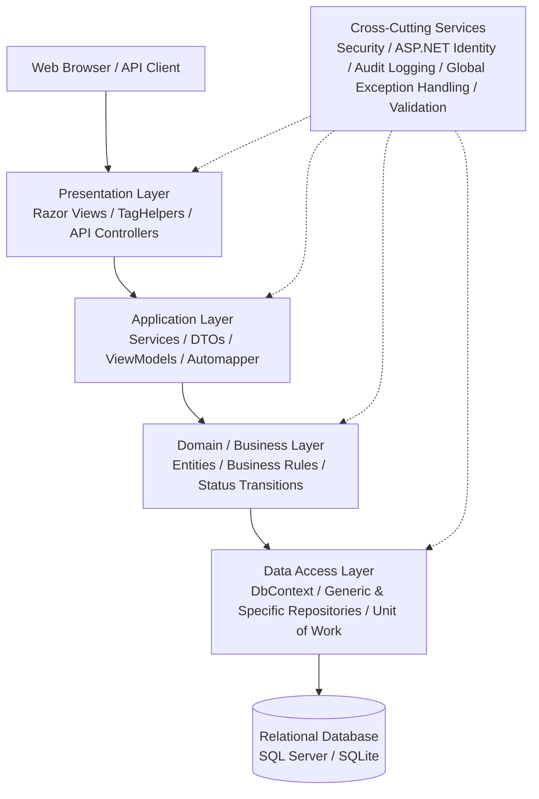
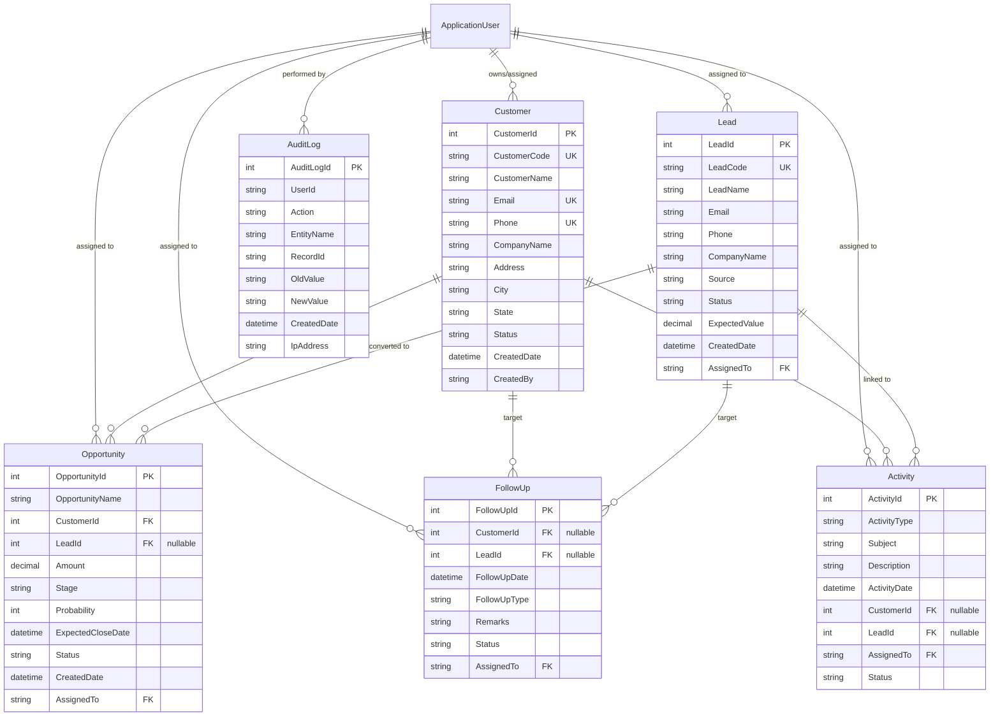
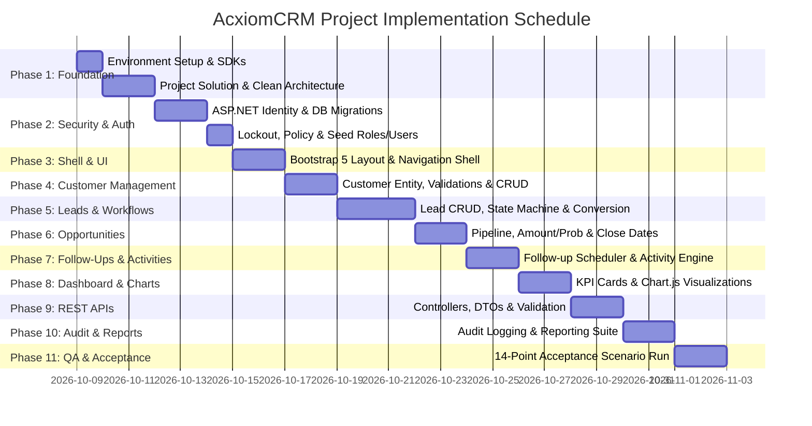

# AcxiomCRM — Comprehensive Project Implementation Plan

## 1. Executive Summary & Objective

**AcxiomCRM** is an enterprise-grade, role-based Customer Relationship Management application designed for sales organizations to manage the complete sales lifecycle: from lead capture and qualification to customer onboarding, opportunity pipeline tracking, follow-ups, and auditability.

This project plan translates the functional and technical specifications into an actionable, phased engineering roadmap. It enforces strict separation of concerns across a layered architecture, integrates **ASP.NET Core Identity** for authentication, lockout, and role-based access control (RBAC), applies multi-tier validations (Client-side, Server-side, and Business logic), provides real-time **Chart.js** analytics dashboards, and exposes authenticated **REST APIs**.

---

## 2. Technical Stack & Architectural Architecture

### 2.1 Technology Stack
| Component | Technology / Library | Details |
| :--- | :--- | :--- |
| **Framework** | .NET 8.0 / .NET 9.0 LTS (C#) | ASP.NET Core MVC + Web API |
| **Authentication & AuthZ** | ASP.NET Core Identity | Cookie auth, PBKDF2/Argon2 hashing, lockout policy |
| **Data Access** | Entity Framework Core (EF Core) | Code-First migrations, parameterized queries (SQLi immune) |
| **Database** | Microsoft SQL Server / LocalDB / SQLite | Normalized relational tables with foreign keys & indexes |
| **UI & Styling** | Bootstrap 5.3 + Bootstrap Icons | Responsive grid, glassmorphism accents, modals, alerts |
| **Validation** | jQuery Validate + Unobtrusive + Fluent/DataAnnotations | Client-side feedback + Server-side ModelState enforcement |
| **Visualizations** | Chart.js 4.x | Lead Status Doughnut, Pipeline Funnel/Bar, Monthly Sales Area |
| **API Architecture** | RESTful Web API + DTOs | Swagger/OpenAPI documentation, token/cookie auth |

### 2.2 Layered System Architecture

---

## 3. Database Entity Model & Schema Design

---

## 4. Multi-Level Validation Specification

| Validation Category | Target Fields | Rule / Requirement | Client Validation | Server Validation | Failure Message |
| :--- | :--- | :--- | :--- | :--- | :--- |
| **Required** | Names, Status, Dates | Mandatory input cannot be null or whitespace | HTML5 / `data-val-required` | `[Required]` attribute | *"[Field] is required."* |
| **Email Format** | Customer, Lead, User | Standard RFC 5322 regex validation | `type="email"` / jQuery Validate | `[EmailAddress]` | *"Enter a valid email address."* |
| **Phone Format** | Customer, Lead | 10-digit mobile number format | Regex pattern mask | Regex Match / Custom Validator | *"Enter a valid 10-digit phone number."* |
| **Email Uniqueness** | Customer | Email cannot exist in Customer table | Remote validation / AJAX | Service uniqueness query | *"A customer with this email already exists."* |
| **Phone Uniqueness** | Customer | Phone cannot exist in Customer table | Remote validation / AJAX | Service uniqueness query | *"A customer with this phone number already exists."* |
| **Duplicate Customer** | Customer | Combination of Name + Company check | Client confirmation | EF Core duplicate query | *"Duplicate customer detected."* |
| **Opportunity Amount**| Opportunity | Must be numeric and strictly > 0 | `min="0.01"` step="0.01" | `[Range(0.01, double.MaxValue)]` | *"Opportunity Amount must be greater than 0."* |
| **Probability** | Opportunity | Integer between 0 and 100 inclusive | `min="0"` `max="100"` | `[Range(0, 100)]` | *"Probability must be between 0 and 100."* |
| **Expected Close Date**| Opportunity | Cannot be in past for active opportunities | `min="YYYY-MM-DD"` (today) | Business rule in Service | *"Expected Close Date cannot be in the past."* |
| **Follow-Up Date** | FollowUp | Cannot be earlier than today for new/planned | `min="YYYY-MM-DD"` (today) | Business rule in Service | *"Follow-up date cannot be earlier than today."* |
| **Lead Status** | Lead | Allowed status set: New, Contacted, Qualified, Lost, Converted | Select drop-down validation | Enum/whitelist validation | *"Invalid lead status selected."* |

---

## 5. Role-Based Authorization & Permission Matrix

| Module / Action | Admin | Manager | Sales Executive | Implementation Mechanism |
| :--- | :---: | :---: | :---: | :--- |
| **Dashboard** | Full system stats | Team pipeline & team leads | Assigned leads, customers & follow-ups | `[Authorize]` + Query Scope filtering |
| **Customer CRUD** | View/Create/Edit/Delete all | View/Create/Edit all | View/Create/Edit assigned | Ownership filter in repository |
| **Lead CRUD & Convert**| Full control | Full team control | Create/Edit/Convert assigned | Status state machine service |
| **Opportunities** | Full pipeline access | Team pipeline & approvals | Assigned opportunities | Calculated weighted pipeline filter |
| **Follow-Ups** | View/Reassign all | View/Assign team | Manage assigned / overdue | Date alert query engine |
| **User & Role Admin** | **Full Access** (Create, edit roles, unlock) | **Denied** | **Denied** | `[Authorize(Roles = "Admin")]` |
| **Audit Logs** | **Full Access** (Filter, view, export) | Read-only team actions (optional) | **Denied** | `[Authorize(Roles = "Admin")]` |
| **REST APIs** | Full API endpoints | Authorized scoped endpoints | Authorized assigned endpoints | JWT / Cookie bearer authorization |
| **Reports** | All reports + Audit report | Team pipeline, Conversion, Rep performance | Assigned summary report | Role-scoped SQL aggregations |

---

## 6. Phased Implementation Roadmap

### Detailed Phase Work Breakdown

#### **Phase 1: Environment Setup & Solution Architecture**
* **Goal**: Establish the project directory structure, install .NET SDK, and set up the layered architecture.
* **Tasks**:
  1. Verify and install .NET 8.0 SDK using Windows Package Manager (`winget install Microsoft.DotNet.SDK.8`).
  2. Create Solution `AcxiomCRM.sln` with modular projects:
     - `AcxiomCRM.Web`: ASP.NET Core MVC + API Controllers + Views + ViewModels.
     - `AcxiomCRM.Core`: Domain Entities, Enums, Interfaces, Business Rule specifications.
     - `AcxiomCRM.Infrastructure`: EF Core DbContext, Migrations, Repositories, Identity config, Audit Logger.
     - `AcxiomCRM.Services`: Service implementations, DTO mappings, Lead conversion workflows.
  3. Configure database connection string (`appsettings.json`) targeting LocalDB/SQL Server/SQLite.

#### **Phase 2: Authentication, Security & ASP.NET Identity**
* **Goal**: Implement zero-plaintext authentication, password policy, account lockout, and role seeding.
* **Tasks**:
  1. Extend `IdentityUser` to `ApplicationUser` (adding `FullName`, `CreatedDate`, `IsActive`).
  2. Configure password policy:
     - Minimum 8 characters, requiring uppercase, lowercase, digit, and non-alphanumeric.
  3. Configure Account Lockout:
     - `MaxFailedAccessAttempts = 5`, `DefaultLockoutTimeSpan = 15 minutes`.
  4. Seed database with predefined roles (`Admin`, `Manager`, `SalesExecutive`) and default seed accounts (`admin@acxiomcrm.com`, `manager@acxiomcrm.com`, `sales@acxiomcrm.com`).
  5. Implement `AccountController`: Login, Register, Logout, AccessDenied, and Account Lockout view.
  6. Enforce `[ValidateAntiForgeryToken]` across all POST actions and register Anti-Forgery middleware.

#### **Phase 3: Application Shell, UI Theme & Navigation**
* **Goal**: Build an intuitive, responsive Bootstrap 5 interface that responds to role permissions.
* **Tasks**:
  1. Create `_Layout.cshtml` with top navbar, collapsible sidebar, user profile dropdown, and breadcrumbs.
  2. Dynamically render menu items based on `User.IsInRole()`:
     - Admin: Dashboard, Customers, Leads, Opportunities, Follow-Ups, Activities, User Management, Audit Logs, Reports.
     - Manager: Dashboard, Customers, Leads, Opportunities, Follow-Ups, Activities, Reports.
     - SalesExecutive: Dashboard, My Customers, My Leads, My Opportunities, My Follow-Ups.
  3. Implement global notification toasts (Success, Error, Warning) and SweetAlert2 confirmation dialogs for deletes.

#### **Phase 4: Customer Management Module**
* **Goal**: Complete Customer lifecycle with multi-tier validation and duplicate prevention.
* **Tasks**:
  1. Implement `Customer` entity and EF Core configuration with unique indexes on `Email` and `Phone`.
  2. Implement `CustomerViewModel` with client-side unobtrusive validation annotations.
  3. Build `CustomerService` with business validation:
     - Check email/phone uniqueness before save.
     - Prevent duplicate creation (Name + Company match).
  4. Implement `CustomerController` (List with search/filter, Create, Details, Edit, Delete).
  5. Hook customer mutations into the `AuditLog` service.

#### **Phase 5: Lead Management & Conversion Workflow**
* **Goal**: Track leads from initial capture to qualification and conversion.
* **Tasks**:
  1. Model `Lead` entity with statuses: `New`, `Contacted`, `Qualified`, `Unqualified`, `Converted`, `Lost`.
  2. Implement Lead state machine validation:
     - Disallow invalid transitions (e.g. from `Lost` to `Converted`).
  3. Implement **Lead Conversion Workflow**:
     - Action to convert a `Qualified` lead into a new `Customer` record and optional initial `Opportunity`.
     - Mark lead status as `Converted`.
     - Log conversion in `AuditLog`.
  4. Implement Search & Filter by Lead Name, Company, Status, and Assigned Rep.

#### **Phase 6: Opportunity Management & Sales Pipeline**
* **Goal**: Manage sales opportunities, calculate weighted values, and enforce strict date/value rules.
* **Tasks**:
  1. Model `Opportunity` entity with stages: `Qualification`, `Proposal`, `Negotiation`, `Won`, `Lost`.
  2. Enforce Business Rules:
     - `Amount > 0` for active opportunities.
     - `Probability` between 0 and 100.
     - `ExpectedCloseDate` cannot be in the past for active opportunities (`Stage != Won` and `Stage != Lost`).
     - Calculate Weighted Pipeline: `WeightedValue = Amount * (Probability / 100.0)`.
  3. Build Opportunity Kanban/List view with stage badges and pipeline total metrics.

#### **Phase 7: Follow-Up & Activity Management**
* **Goal**: Schedule, track, and complete sales communications and tasks.
* **Tasks**:
  1. Implement `FollowUp` entity with types (`Call`, `Email`, `Meeting`, `Demo`) and statuses (`Planned`, `Completed`, `Missed`, `Cancelled`).
  2. Enforce Business Rule:
     - `FollowUpDate` cannot be in the past for new or planned follow-ups.
  3. Implement `Activity` entity (Call logs, meeting notes, tasks) linked to Customers and Leads.
  4. Build "Upcoming & Overdue Follow-Ups" widget with status toggle (Mark Complete / Reschedule).

#### **Phase 8: Role-Based Dashboard & Chart.js Analytics**
* **Goal**: Deliver a dynamic, interactive analytics command center.
* **Tasks**:
  1. Create `DashboardController` calculating metrics based on the current user's role:
     - **Cards**: Total Customers, Total Leads, Open Leads, Total Opportunities, Open, Won, Lost, Total Pipeline Value ($).
  2. Implement three dynamic **Chart.js** visualizations:
     - **Lead Status Distribution**: Doughnut chart (`New`, `Contacted`, `Qualified`, `Lost`, `Converted`).
     - **Opportunity Pipeline Funnel/Bar**: Bar chart showing count and value per stage (`Qualification`, `Proposal`, `Negotiation`, `Won`, `Lost`).
     - **Monthly Sales Performance**: Line/Area chart of deals closed over the past 6 months.
  3. Integrate date range filters: `Today`, `This Week`, `This Month`, `Custom Range`.

#### **Phase 9: REST API Architecture & DTOs**
* **Goal**: Expose secure, decoupled endpoints returning proper HTTP status codes.
* **Tasks**:
  1. Build API Controllers:
     - `api/auth`: Login / Token / Session check
     - `api/customers`: GET, GET/{id}, POST, PUT/{id}, DELETE/{id}
     - `api/leads`: GET, POST, GET/{id}, PUT/{id}
     - `api/opportunities`: GET, POST, GET/{id}, PUT/{id}
     - `api/followups`: GET, POST
     - `api/reports/pipeline`: GET
  2. Implement Request/Response DTOs (e.g. `CustomerDto`, `CreateCustomerRequest`, `OpportunityResponseDto`).
  3. Strict response status codes: `200 OK`, `201 Created`, `400 Bad Request`, `401 Unauthorized`, `403 Forbidden`, `404 Not Found`, `409 Conflict`.
  4. Ensure zero password hashes or internal EF tracking metadata are exposed.

#### **Phase 10: Global Audit Logging & Reporting Engine**
* **Goal**: Capture all audit-worthy actions and generate management reports.
* **Tasks**:
  1. Implement `AuditLogService` with automatic interceptor or explicit service logging:
     - Logs: User ID, Action (`Login`, `FailedLogin`, `Create`, `Update`, `Delete`, `RoleChange`), EntityName, RecordId, OldValue, NewValue, Timestamp, IP Address.
     - Store logs as append-only (no edit/delete endpoints).
  2. Build Comprehensive Reporting Suite:
     - Customer Report (by status, owner, date)
     - Lead Report (source, conversion rate, owner)
     - Follow-Up Report (completed vs overdue)
     - Opportunity & Pipeline Report (stage-wise, owner-wise)
     - User Activity & Audit Report (Admin only)
  3. Add CSV / Excel export functionality.

#### **Phase 11: End-to-End Verification (14-Point Acceptance Test)**
* **Goal**: Execute the explicit acceptance scenario outlined in Section 17.19 of the project specification.

| # | Acceptance Test Case | Expected Result | Pass Criteria |
| :-: | :--- | :--- | :--- |
| **1** | Open CRM without authentication | Redirected to `/Account/Login` | Unauthenticated access blocked |
| **2** | Login with valid credentials | Redirected to `/Dashboard` | Dashboard loads with user KPIs |
| **3** | Customer form with invalid email/phone | Client validation fires, submit blocked | Inline red error messages visible |
| **4** | Direct POST request with invalid data | Server-side `ModelState` returns 400 | Database rejects invalid data |
| **5** | Opportunity with Amount <= 0 | Rejected with error | *"Amount must be greater than 0"* |
| **6** | Opportunity with Probability > 100 | Rejected with error | *"Probability must be between 0 and 100"* |
| **7** | Opportunity with past Close Date | Rejected for active opportunity | *"Close date cannot be in past"* |
| **8** | Follow-Up scheduled in past | Rejected with error | *"Date cannot be earlier than today"* |
| **9** | Login as `SalesExecutive` | Access limited to assigned records | Cannot view other reps' data |
| **10** | Login as `Manager` | Team pipeline & reports accessible | Cannot access User Admin or Audit |
| **11** | Login as `Admin` | Full access to Users, Roles, Audit Logs | User management actions active |
| **12** | Create/Update/Delete record | Audit entry created in `AuditLogs` | Correct `Action`, `OldValue`, `NewValue` |
| **13** | GET `/api/customers` with auth | Returns HTTP 200 with JSON DTO list | Secure, no password hash exposed |
| **14** | Dashboard KPI & Chart.js inspection | Metrics & 3 Chart.js graphs render data | Fully functional client visuals |

---

## 7. Immediate Next Steps to Begin Execution

1. **Environment Setup**: Install .NET 8 SDK on the environment using `winget install Microsoft.DotNet.SDK.8`.
2. **Project Scaffolding**: Create the solution `AcxiomCRM.sln` and core project libraries in `c:\axioms`.
3. **Database & Identity**: Configure EF Core DbContext, Identity, and run initial migrations with role and user seeders.
